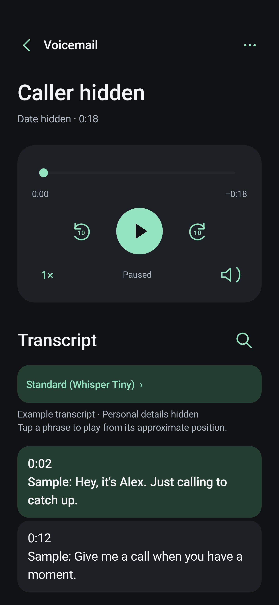
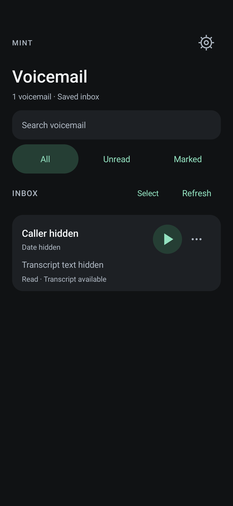
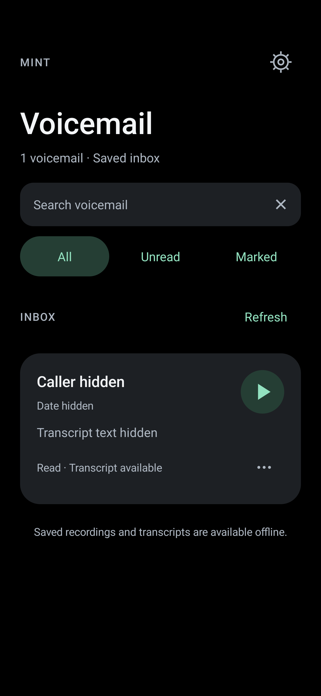
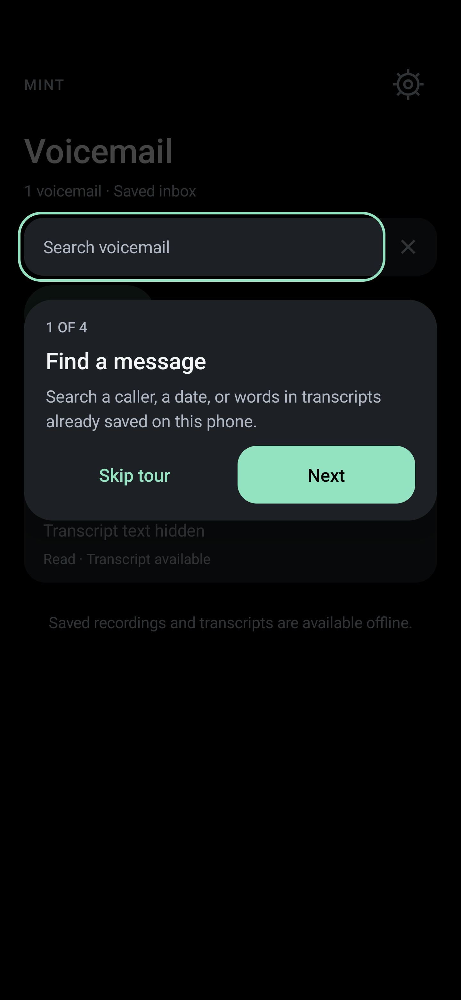

# Visual Voice Mail

An investigation and prototype for a free, open-source Android visual voicemail client for Mint Mobile, starting with the Samsung Galaxy S24 Ultra.

The app uses the existing carrier mailbox, works alongside the user's chosen dialer, and adds a clear inbox and on-device transcription.

An independently signed Android app now authenticates to Mint's existing voicemail service, loads the real mailbox, and downloads and plays recordings without carrier privileges or a default-dialer role. Version 0.14 adds Standard (Whisper Tiny) and Enhanced (Whisper Base) quality choices directly on the transcript page and in Settings, plus consistent tap feedback and reduced-motion support. English transcription, phrase-based tap-to-play, transcript search, and the guided introduction work on the phone.

## Screenshots

Player/settings/quality screenshots are from version 0.14; inbox/onboarding screenshots are from version 0.13 on the S24 Ultra. Caller details and dates are hidden before capture; transcript screenshots use labeled sample text. System status icons are omitted. Select an image to view it at full size.

<table>
  <tr><th>Recording · Dark</th><th>Recording · Light</th><th>Recording · AMOLED</th></tr>
  <tr>
    <td></td>
    <td></td>
    <td></td>
  </tr>
  <tr><th>Inbox · Dark</th><th>Inbox · Light</th><th>Inbox · AMOLED</th></tr>
  <tr>
    <td></td>
    <td></td>
    <td></td>
  </tr>
  <tr><th>Guided controls</th><th>Interactive introduction</th><th>Settings</th></tr>
  <tr>
    <td></td>
    <td></td>
    <td></td>
  </tr>
</table>

## Documentation

- [Carrier protocol and device findings](docs/carrier-research.md)
- [Independent probe results and limits](docs/independent-probe.md)
- [Mailbox access validation](docs/mailbox-access.md)
- [Live playback validation](docs/playback-validation.md)
- [Protected sessions and offline playback](docs/offline-inbox.md)
- [Native inbox, light/dark themes, and playback controls](docs/inbox-design.md)
- [Search, read/unread status, and reversible deletion marks](docs/search-actions.md)
- [App settings and playback preferences](docs/settings.md)
- [Motion and responsive tap feedback](docs/motion.md)
- [First-use tutorial and replayable help](docs/tutorial.md)
- [App icon and branding assets](docs/branding/README.md)
- [LinkedIn promo video and post assets](media/promo/README.md)
- [New voicemail notifications and background-check limits](docs/notifications.md)
- [On-device transcription, search, and validation](docs/transcription.md)
- [Five-question UX pressure test and open findings](docs/ux-pressure-test.md)
- [Build the voicemail app](app/README.md)
- [Build the diagnostic Android app](probe/README.md)

## Development

Use `feature/` feature branches, commit each coherent change, and merge changes to `main` through a reviewed pull request with relevant validation.

Downloaded APKs, decompiled proprietary application code, local tools, signing keys, and private device captures are excluded from version control. Original implementation, research tooling, findings, and reviewed app screenshots with personal details removed belong in this repository.
