# Visual Voice Mail

An investigation and prototype for a free, open-source Android visual voicemail client for Mint Mobile, starting with the Samsung Galaxy S24 Ultra.

The app uses the existing carrier mailbox, works alongside the user's chosen dialer, and adds a clear inbox and on-device transcription.

[Download the signed v0.32 preview APK](https://github.com/5ham5h33r/visual-voicemail/releases/tag/v0.32). The release includes a checksum and public signing-certificate report. Repository access is required while this project is private. See [release builds and upgrade notes](docs/releases.md).

Version 0.31 authenticates to Mint's existing voicemail service, loads the mailbox, and downloads and plays recordings without carrier privileges or a default-dialer role. The inbox header condenses as you scroll, leaving a compact toolbar with search, filters, and Settings. Swipe or tap between All, Unread, and Saved, with clear empty states for each view. Select messages from Inbox actions or by long-press. The inbox supports contact and transcript search, multi-selection, queued transcripts, read/unread updates, and carrier removal with verified local copies retained in Saved.

Get Started opens the inbox directly; the interactive introduction and control tour remain optional. Model downloads support verified Pause/Resume. Cached playback, sharing, export, and transcription remain available during slow carrier work. Settings offers an optional mark-as-read-on-play policy, off by default. TalkBack focus, large-text selection controls, and export/interruption recovery have native emulator coverage; the [final UX review](docs/ux-final-review.md) records the remaining human and carrier validation limits.

Transcription runs on the phone with Standard (Whisper Tiny), Enhanced (Whisper Base), or Highest quality (full Whisper Large v3). Tiny and Base are English-only; Large v3 adds automatic/manual language selection and a separate English translation. Original and translated text are both searchable. The recording page includes Call and Share actions for text or audio. Settings also includes personal greeting setup with local recording/import, preview, and an explicit carrier-save confirmation. Large needs a 1.78 GB download and much more memory and processing time. Existing transcripts stay until explicitly updated. Settings has local search by name or feature. Phrase-based tap-to-play, transcript search, a guided introduction, consistent tap feedback, and reduced-motion support are included.

## Screenshots

Version 0.31 transcript view with direct Search and inline quality controls, captured on the S24-sized emulator. The caller, date, and text are synthetic sample data; no personal voicemail or phone number appears.

<a href="docs/screenshots/transcript-search.png">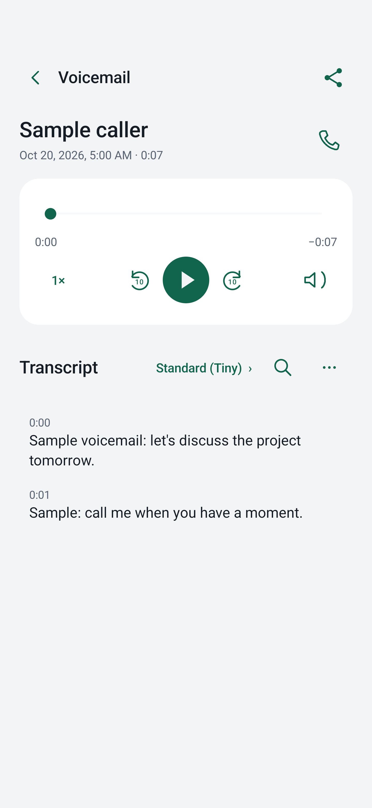</a>

Recording screenshots show version 0.25 with smaller icons and balanced player spacing. Other screenshots from earlier versions show the compact interface on the S24 Ultra, including version 0.18 expanded/collapsed headers and bulk selection. Long-inbox and selection examples use synthetic messages; the model-choice page is from version 0.16. Caller details and dates are hidden before capture; transcript screenshots use labeled sample text. Some images still show the earlier Marked label; version 0.24 uses Saved. System status icons are omitted. Select an image to view it at full size.

<table>
  <tr><th>Recording · Dark</th><th>Recording · Light</th><th>Recording · AMOLED</th></tr>
  <tr>
    <td></td>
    <td><a href="docs/screenshots/recording-light.png">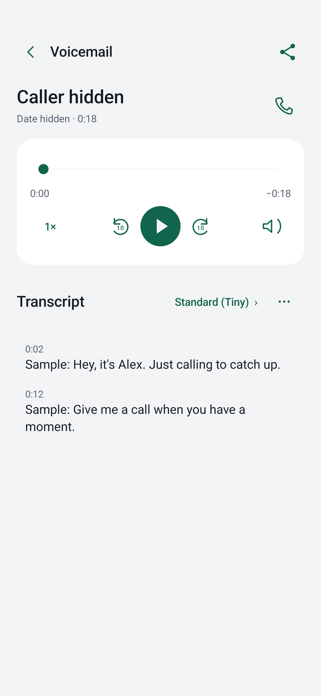</a></td>
    <td><a href="docs/screenshots/recording-amoled.png">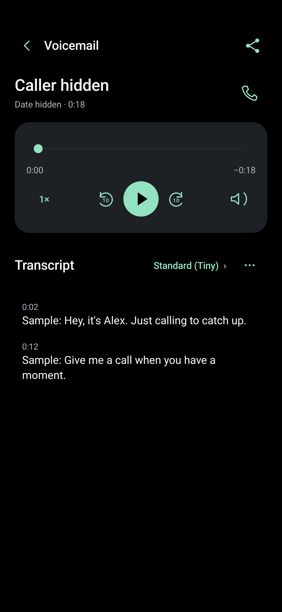</a></td>
  </tr>
  <tr><th>Inbox · Dark</th><th>Inbox · Light</th><th>Inbox · AMOLED</th></tr>
  <tr>
    <td></td>
    <td></td>
    <td></td>
  </tr>
  <tr><th>Scrolled inbox · Light</th><th>Scrolled inbox · Dark</th><th>Scrolled inbox · AMOLED</th></tr>
  <tr>
    <td><a href="docs/screenshots/collapsed-light.png">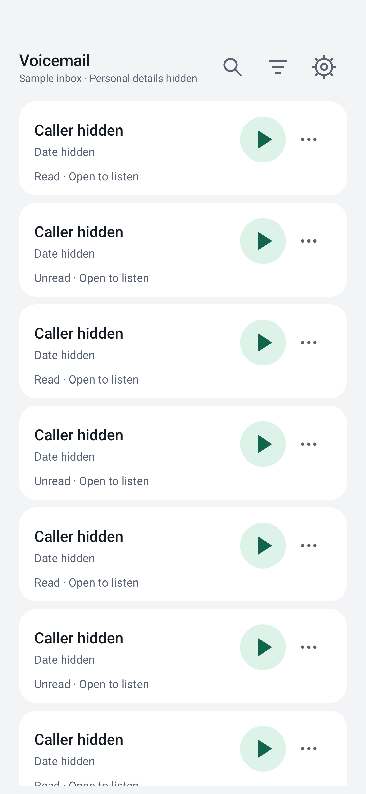</a></td>
    <td><a href="docs/screenshots/collapsed-dark.png">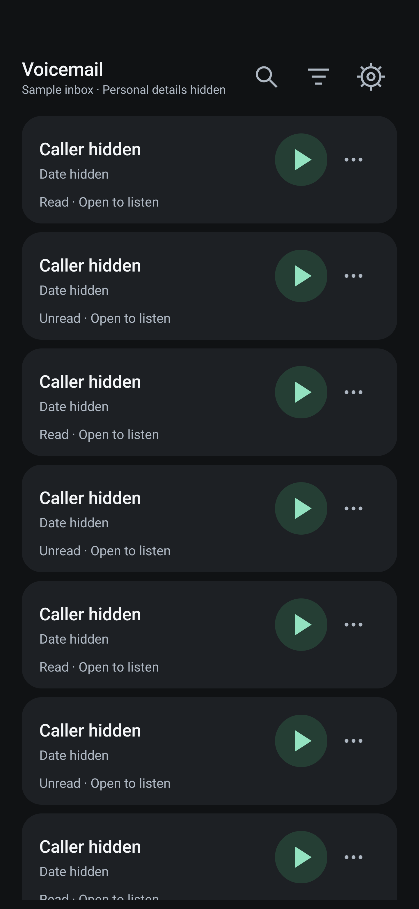</a></td>
    <td><a href="docs/screenshots/collapsed-amoled.png">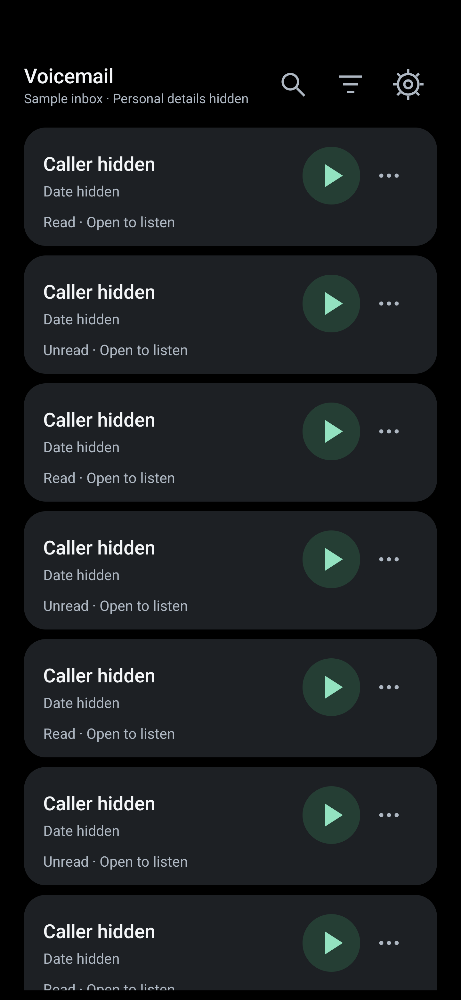</a></td>
  </tr>
  <tr><th>Guided controls</th><th>Interactive introduction</th><th>Settings</th></tr>
  <tr>
    <td></td>
    <td><a href="docs/screenshots/onboarding-transcript.png">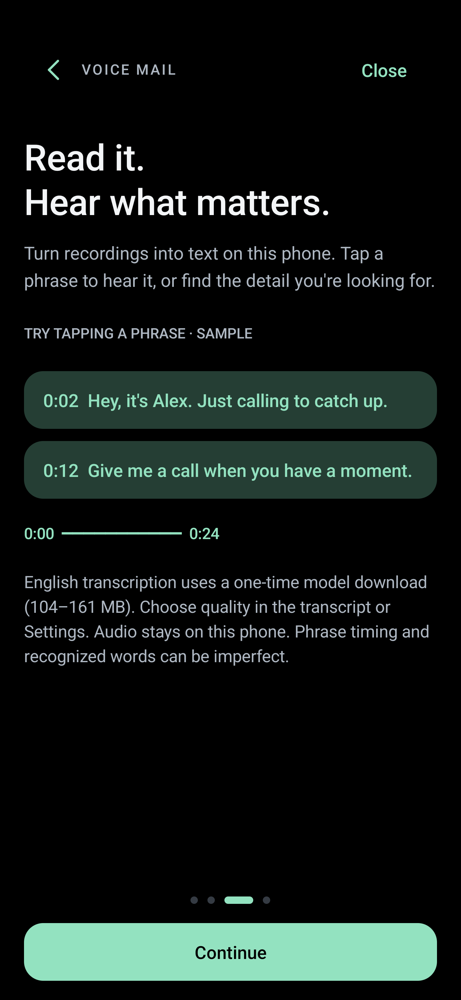</a></td>
    <td><a href="docs/screenshots/settings-light.png">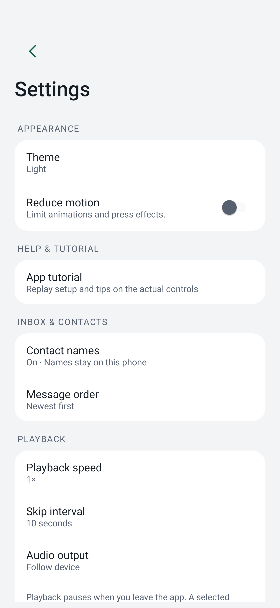</a></td>
  </tr>
  <tr><th>Bulk actions · Light</th><th>Bulk actions · Dark</th><th>Bulk actions · AMOLED</th></tr>
  <tr>
    <td><a href="docs/screenshots/bulk-light.png">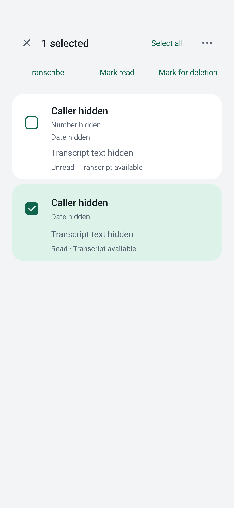</a></td>
    <td><a href="docs/screenshots/bulk-dark.png">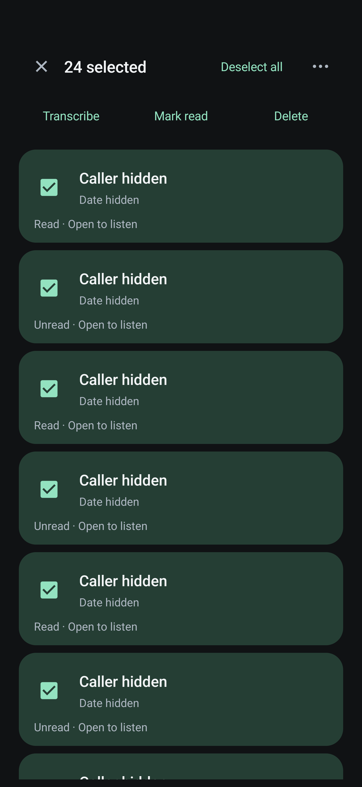</a></td>
    <td><a href="docs/screenshots/bulk-amoled.png">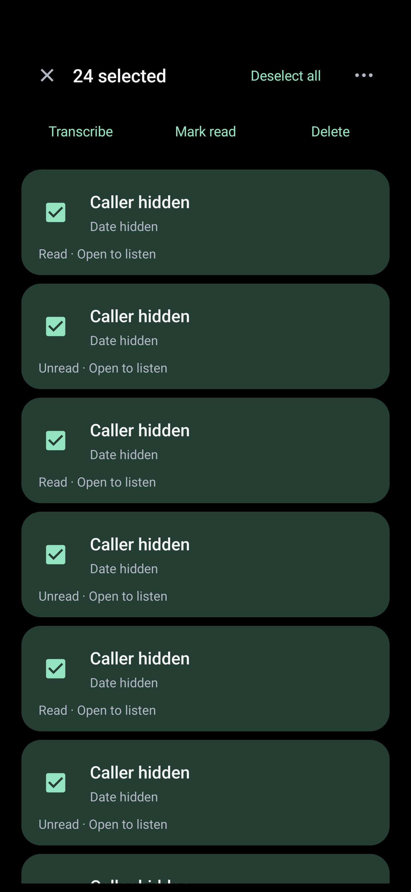</a></td>
  </tr>
</table>

<table>
  <tr><th>Inbox actions · Light</th><th>Inbox actions · Dark</th><th>Inbox actions · AMOLED</th></tr>
  <tr>
    <td>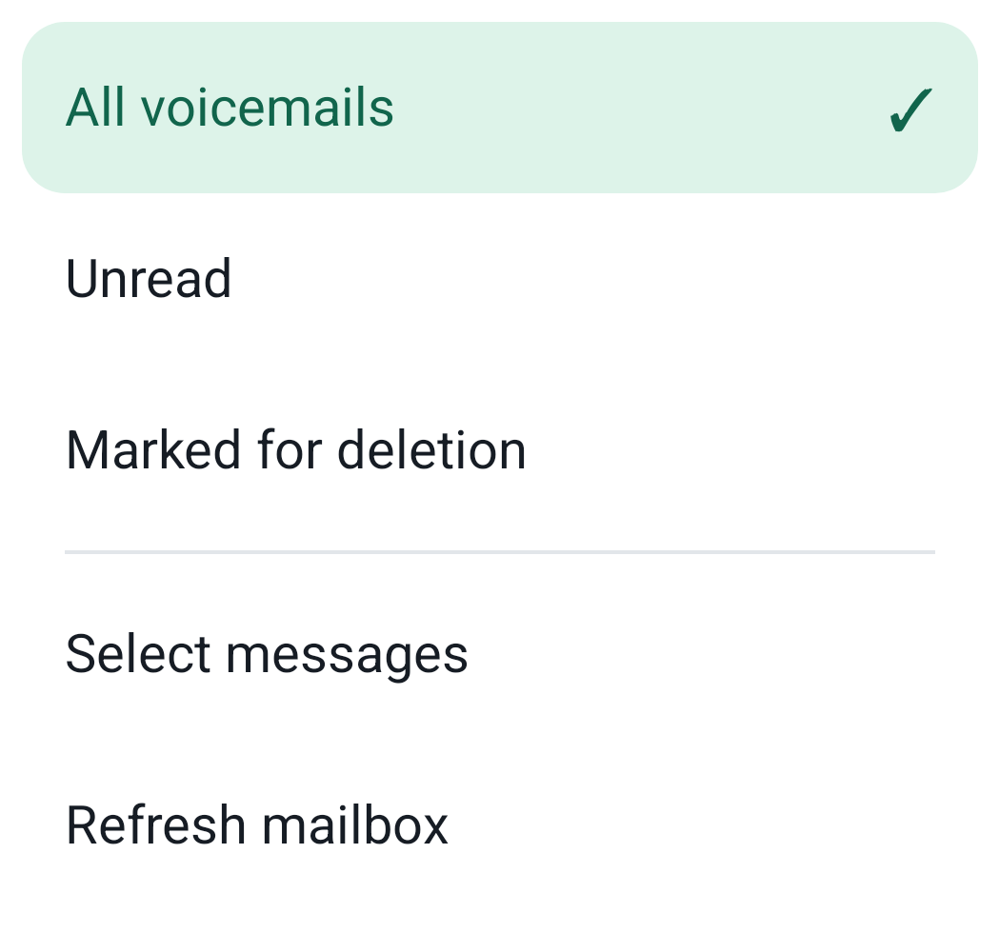</td>
    <td>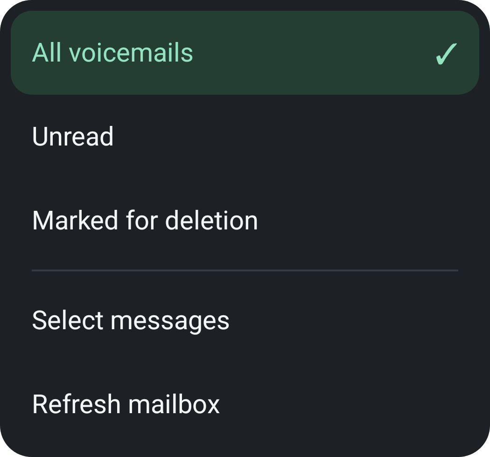</td>
    <td></td>
  </tr>
</table>

<a href="docs/screenshots/greeting-light.png">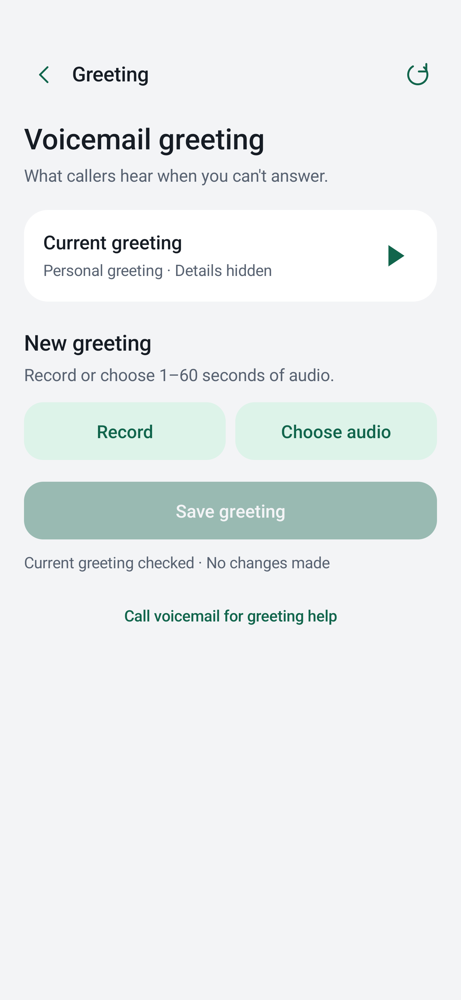</a>

<a href="docs/screenshots/settings-search.png">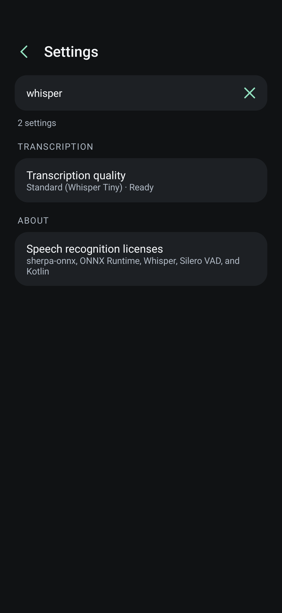</a>

<a href="docs/screenshots/transcription-quality.png">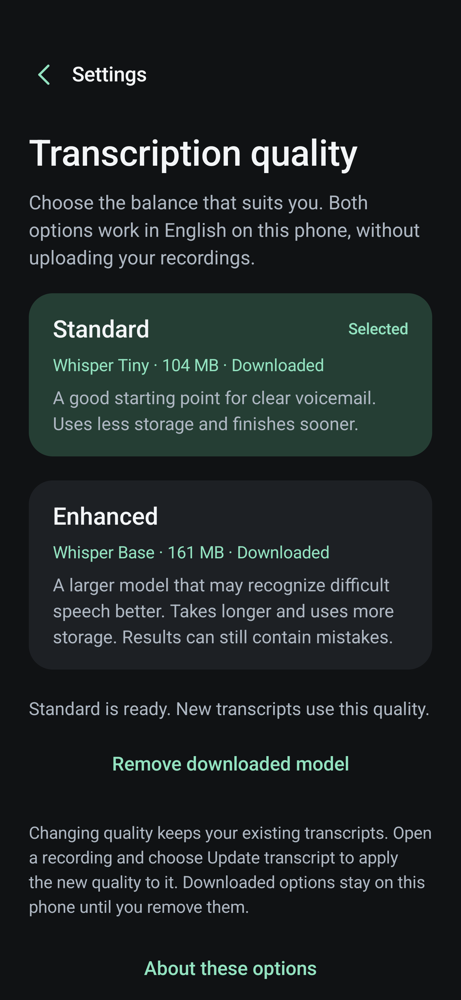</a>

## Documentation

[Emulator UI testing](docs/emulator-testing.md) uses public audio and sample transcripts while the phone is unavailable.

The [event-driven notification investigation](docs/event-driven-notifications.md) explains current SMS/push eligibility and limits.

The [final five-question UX review](docs/ux-final-review.md) covers the whole app, the completed follow-up changes, and remaining usability gaps. [Implementation evidence](docs/ux-improvements.md) records each phase's scope and checks.

- [Carrier protocol and device findings](docs/carrier-research.md)
- [Independent probe results and limits](docs/independent-probe.md)
- [Mailbox access validation](docs/mailbox-access.md)
- [Live playback validation](docs/playback-validation.md)
- [Protected sessions and offline playback](docs/offline-inbox.md)
- [Native inbox, light/dark themes, and playback controls](docs/inbox-design.md)
- [Carrier removal and protected saved recordings](docs/carrier-deletion.md)
- [Search and read/unread status](docs/search-actions.md)
- [Inbox selection and bulk actions](docs/bulk-actions.md)
- [Scrolling inbox header](docs/inbox-header.md)
- [App settings and playback preferences](docs/settings.md)
- [Motion and responsive tap feedback](docs/motion.md)
- [Compact layout and back navigation](docs/compact-interface.md)
- [First-use tutorial and replayable help](docs/tutorial.md)
- [App icon and branding assets](docs/branding/README.md)
- [LinkedIn promo video and post assets](media/promo/README.md)
- [New voicemail notifications and background-check limits](docs/notifications.md)
- [On-device transcription, search, and validation](docs/transcription.md)
- [Multilingual transcripts and English translation](docs/translation.md)
- [Calling and sharing recordings or text](docs/recording-actions.md)
- [Personal greeting setup and validation limits](docs/greeting.md)
- [Five-question UX pressure test and open findings](docs/ux-pressure-test.md)
- [Build the voicemail app](app/README.md)
- [Build the diagnostic Android app](probe/README.md)

## Development

Use `feature/` feature branches, commit each coherent change, and merge changes to `main` through a reviewed pull request with relevant validation.

Downloaded APKs, decompiled proprietary application code, local tools, signing keys, and private device captures are excluded from version control. Original implementation, research tooling, findings, and reviewed app screenshots with personal details removed belong in this repository.
