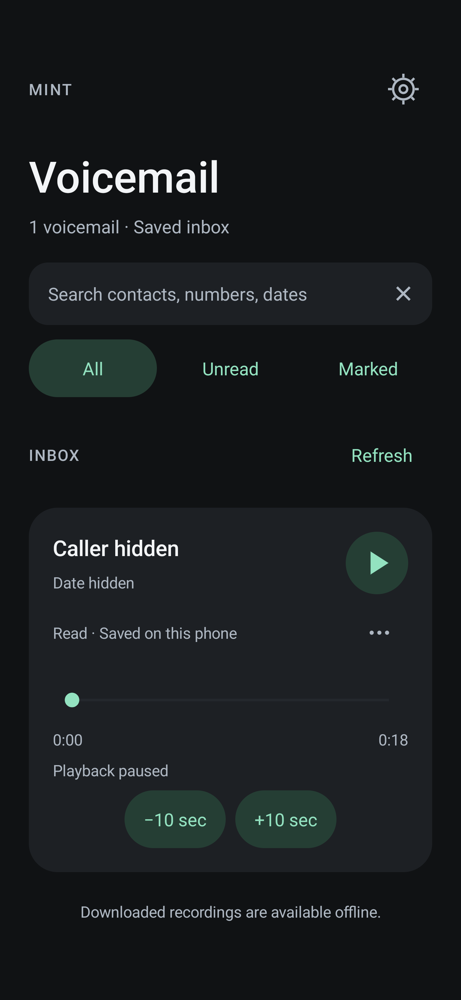
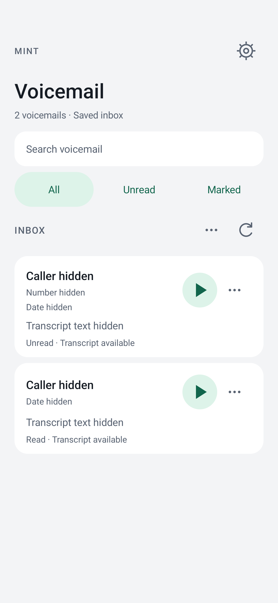
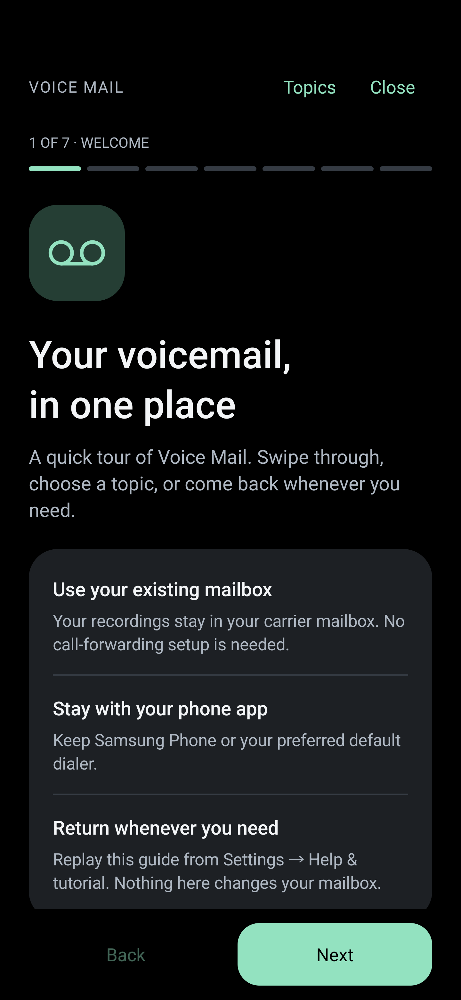

# Visual Voice Mail

An investigation and prototype for a free, open-source Android visual voicemail client for Mint Mobile, starting with the Samsung Galaxy S24 Ultra.

The intended app uses the existing carrier mailbox, works alongside the user's chosen dialer, and adds a clear inbox and on-device transcription.

An independently signed Android app now authenticates to Mint's existing voicemail service, loads the real mailbox, and downloads and plays recordings without carrier privileges or a default-dialer role. Transcription is intentionally deferred until the user has tried playback.

## Screenshots

Captured from version 0.11. Caller details and message dates are hidden; system status icons are omitted. Select an image to view it at full size.

<table>
  <tr>
    <th>Dark inbox</th>
    <th>Playback</th>
    <th>Light inbox</th>
  </tr>
  <tr>
    <td></td>
    <td></td>
    <td></td>
  </tr>
  <tr>
    <th>Settings</th>
    <th>AMOLED inbox</th>
    <th>First-use tutorial</th>
  </tr>
  <tr>
    <td></td>
    <td></td>
    <td></td>
  </tr>
</table>

## Documentation

- [Carrier protocol and device findings](docs/carrier-research.md)
- [Independent probe results and limits](docs/independent-probe.md)
- [Mailbox access validation](docs/mailbox-access.md)
- [Live playback validation](docs/playback-validation.md)
- [Protected sessions and offline playback](docs/offline-inbox.md)
- [Native inbox, light/dark themes, and playback controls](docs/inbox-design.md)
- [Search, read/unread status, and reversible deletion marks](docs/search-actions.md)
- [App settings and playback preferences](docs/settings.md)
- [First-use tutorial and replayable help](docs/tutorial.md)
- [App icon and branding assets](docs/branding/README.md)
- [New voicemail notifications and background-check limits](docs/notifications.md)
- [Planned transcription and tap-to-play requirements](docs/transcription-requirements.md)
- [Five-question UX pressure test and open findings](docs/ux-pressure-test.md)
- [Build the voicemail app](app/README.md)
- [Build the diagnostic Android app](probe/README.md)

## Development

Use `feature/` feature branches, commit each coherent change, and merge changes to `main` through a reviewed pull request with relevant validation.

Downloaded APKs, decompiled proprietary application code, local tools, signing keys, and private device captures are excluded from version control. Original implementation, research tooling, findings, and reviewed app screenshots with personal details removed belong in this repository.
