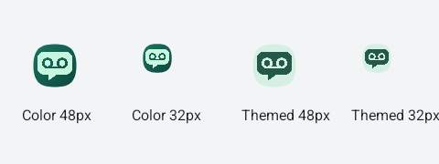

# Voice Mail icon

Version 0.12 introduces a mint speech bubble with voicemail reels cut through it, on a deep-green gradient. The familiar reel shape identifies voicemail, while the bubble represents a saved voice message. The artwork has no text, badges, or baked-in shadows.

| Color icon | Example themed tint |
| --- | --- |
|  |  |

## Assets

- `app-icon.svg`: editable portable artwork with a rounded-square preview mask.
- `app-icon.png`: 512px rendering of the installed Android adaptive icon using the device's mask.
- `app-icon-themed.png`: 512px rendering using the actual monochrome layer with example theme colors. Launcher/wallpaper settings determine the real themed colors.
- `app-icon-small.png`: native 48px and 32px color/themed renders.
- `notification-icon.png`: the matching notification drawable rendered at 24px against a dark surface.
- Android production resources live in `app/res/drawable/ic_launcher_background.xml`, `ic_launcher_foreground.xml`, `ic_notification_voicemail.xml`, and the `mipmap-anydpi-v26`/`mipmap-anydpi-v33` launcher definitions.

The Android layers use a 108dp canvas with a 58×48dp mark inside the central safe area. The background is full bleed; the launcher supplies its own mask. The foreground's transparent reel cutouts also survive monochrome tinting. Android 13+ uses the explicit monochrome layer, and the manifest supplies the adaptive resource for both normal and round icons. See [Android's adaptive-icon guidance](https://developer.android.com/develop/ui/views/launch/icon_design_adaptive).

Colors: foreground `#C8F7E0`, background gradient `#1B8067` → `#0B3C37`. Example themed colors are `#24594A` on `#D5F0E3`. All artwork is original and covered by the repository's MIT license.

## Validation

Built, signature-verified, and installed version 0.12 on the S24 Ultra. A read-only native rendering check confirmed that the installed icon is an AdaptiveIconDrawable, has a monochrome layer, preserves the reel cutouts, and keeps every foreground pixel inside both the central 66dp square and a centered 66dp circle. Visually reviewed the full-size color/themed renders, 48px/32px versions, and the 24px notification symbol.

The PNGs were rendered directly from the installed Android drawables and contain only icon artwork. The theme sample was rendered without changing launcher or wallpaper settings. Full themed-launcher behavior and additional device masks/Android versions still need broader coverage.
