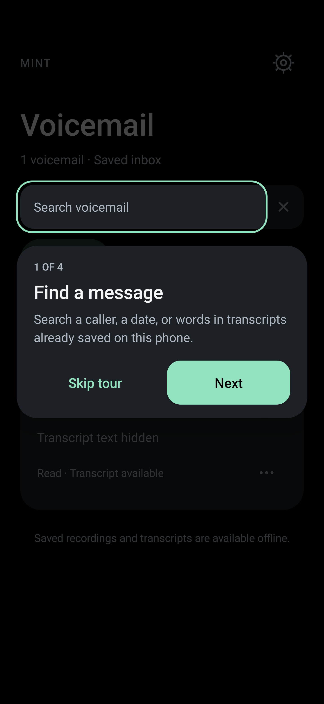

# Introduction and guided controls in version 0.13

The optional first-use flow has four short screens: welcome, voicemail management with reversible sample actions, an interactive transcript example, and permission setup. Contacts and notifications are requested only when their explicit Enable button is selected. Denying or skipping them does not block the inbox. The speech model download waits until a recording needs transcription.

Get Started opens the real inbox and highlights Search, All/Unread/Marked, Settings, and an actual recording (or Connect in an empty mailbox). Tips sit beside the highlighted control, with Next and Skip tour. Tapping the final highlighted recording invokes that recording's real action. Its detail screen then highlights the player, transcript, and transcript search. No sample action modifies a carrier message.

The introduction can be skipped, resumed after interruption, or replayed from Settings → Help & tutorial → App tutorial. Setup choices are preserved. Back returns to the previous introduction screen; Back or Skip tour dismisses a spotlight. An explicit voicemail notification still bypasses the introduction to reach the inbox.

Text scrolls when needed. Native font scaling, 48 dp secondary controls, Light/Dark/AMOLED colors, and accessible control labels apply throughout. Short 180 ms fade/position transitions respect Android's disabled-animation setting. The spotlight hides covered controls from accessibility traversal while presenting its instructions and navigation.

## Design rationale

Apple's [onboarding guidance](https://developer.apple.com/design/human-interface-guidelines/onboarding) informed the brief, optional introduction, interactive examples, contextual instruction, and delayed model download. Its [motion guidance](https://developer.apple.com/design/human-interface-guidelines/motion) informed short feedback transitions that do not gate input. The implementation uses Android controls, permissions, back navigation, and accessibility settings.

## Device verification

Thirty-two S24 Ultra checks cover introduction navigation, sample actions, permission-setup visibility, Get Started, all inbox tips, tapping the actual highlighted recording, all recording tips, replacing inbox rows during the tour, and skipping later recording tips. Captures verify Light, Dark, and AMOLED, with personal information removed before capture. Full TalkBack traversal, large-font/landscape layout, denied permissions on a fresh installation, and broader device coverage remain separate checks.
