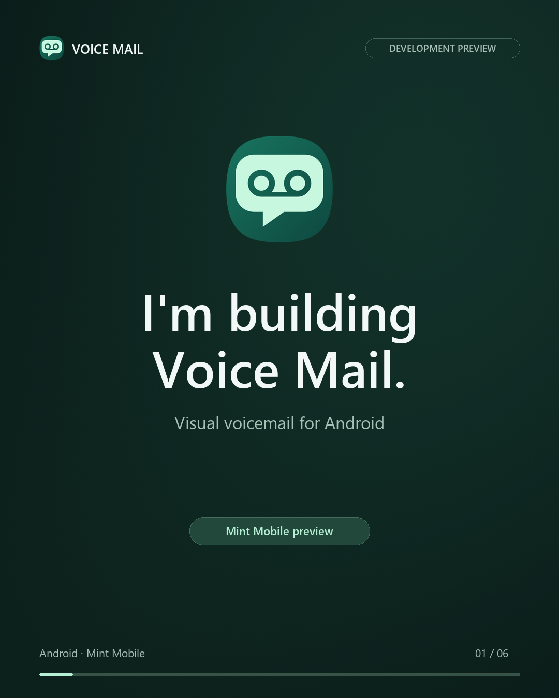

# LinkedIn promo

A 26-second, caption-led product preview using the app's reviewed screenshots and original icon. The edit covers mailbox/dialer compatibility on Mint, inbox search, playback, and Light/Dark/AMOLED themes. It identifies the app as a development preview and labels transcription as planned. No download or public-source availability is claimed.

## Deliverables

- [MP4 video](exports/voice-mail-linkedin.mp4): 1080×1350, 4:5, 30 fps, H.264 video and stereo AAC audio, with fast-start metadata.
- [Cover image](exports/voice-mail-linkedin-cover.png): 1080×1350, taken from the opening composition.
- [Optional caption file](exports/voice-mail-linkedin.srt): timed on-screen copy for accessibility. The main titles are already burned into the video; the audio contains original music without speech.
- [Suggested LinkedIn post](linkedin-post.md): editable copy for the post.



The soundtrack is an original synthesized pad/pluck arrangement, generated by `render.py` without external audio samples. The video contains no personal voicemail audio. Visual inputs are limited to the reviewed images in `docs/screenshots/` and the icon in `docs/branding/`; the edit uses screenshot motion rather than pretending to be a live screen recording. Caller details and dates remain hidden.

The UI captures show version 0.11 and the icon comes from version 0.12. The app's functionality is unchanged between those versions apart from branding. Notification delivery is not promoted as instant. Transcript search, transcription, and permanent deletion are not presented as working features.

## Rebuild

Install Python 3.9+, Pillow, NumPy, and FFmpeg with libx264/AAC support, then run:

```sh
python media/promo/render.py --preview
python media/promo/render.py
```

The preview option writes review frames in ignored `work/`. Rendering streams frames into FFmpeg and generates the soundtrack locally. Segoe UI is used when available, with DejaVu Sans/Arial fallbacks; `PROMO_FONT_REGULAR` and `PROMO_FONT_BOLD` can select installed fonts. No font files are redistributed. Inspect text placement again if fonts or copy change.

The final MP4 uses square pixels, BT.709 limited-range video, and an AAC mix normalized toward −18 LUFS with a −2 dB true-peak target. The cover and SRT are regenerated with the video. Review any replacement input image for personal information before rendering.

## Verification

The delivered file contains 780 H.264 frames at 30 fps, lasts 26.000 seconds, and occupies 1,998,007 bytes. FFprobe confirmed 1080×1350 dimensions, square pixels, BT.709 color, and 48 kHz stereo AAC. A full video/audio decode completed without errors. Measured soundtrack loudness was −18.20 LUFS with a −7.02 dB true peak. Representative frames from the encoded file were reviewed for text placement, accurate feature claims, and hidden caller details. The MP4 places its movie metadata before media data for streaming playback.

## Posting

Upload the MP4 as a native video post, optionally upload the cover and caption file, and edit the suggested post copy. This task creates the files without posting to LinkedIn. The 4:5 dimensions, duration, and frame rate fit LinkedIn's [published video requirements](https://www.linkedin.com/help/linkedin/answer/a7494039). Keep the development-preview/Mint qualification if editing the copy.
