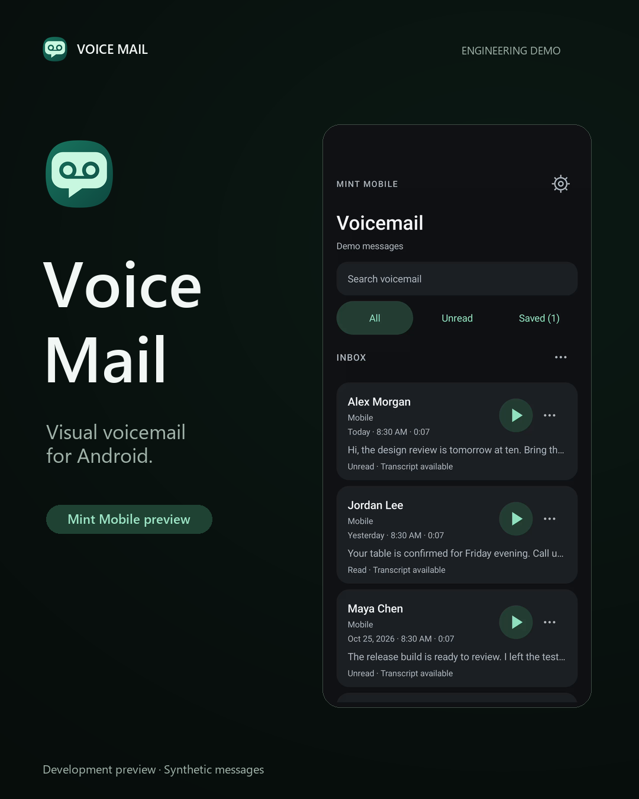

# Voice Mail product demo

A 44-second engineering/product demo of version 0.33. Native app footage shows inbox swipes, contact/transcript search, phrase playback, transcription quality, and multi-selection. An animated diagram explains the carrier/private-storage/Whisper path, followed by Light/Dark/AMOLED captures. Focused crops keep the app readable in a LinkedIn feed.

## Deliverables

- [Product demo MP4](exports/voice-mail-product-demo.mp4): 1080x1350, 4:5, 30 fps, H.264 and stereo AAC, with fast-start metadata.
- [Cover image](exports/voice-mail-product-demo-cover.png).
- [Optional captions](exports/voice-mail-product-demo.srt). Main titles also appear in the picture.
- [Editable LinkedIn post](linkedin-post.md).



The video labels its messages as synthetic. Filming uses eight reserved sample numbers, fictional names, and manually scripted text on the S24-sized API 36 emulator. The displayed transcript text illustrates the interface; it is not recognition output from the public playback fixture. Voicemail audio is muted and excluded from the edit. Only an original synthesized soundtrack plays. No personal phone data, real contacts, credentials, or proprietary app footage are used.

The emulator has no Mint entitlement. Its demo label represents the tested carrier; real carrier compatibility comes from the separate S24 Ultra checks. The diagram distinguishes app-private audio from encrypted metadata. It makes no promise of instant carrier push or guaranteed transcription accuracy. The repository remains private, and the video makes no public download/availability claim.

## Capture and rebuild

Prepare an unauthenticated emulator with the [public sample inbox](../../docs/emulator-testing.md). Build the app and temporary checks with a matching development signer on a fresh emulator; an installed release requires an authorized instrumentation signer. Match the S24 Ultra viewport (1440x3120 at 600 dpi). Run only one instrumentation session at a time:

```sh
python research/check_device_ui.py --test product-demo --serial emulator-5554
```

ProductDemoCapture refuses real hardware, carrier sessions, non-sample IDs, unexpected sample counts, and numbers outside the reserved fixture range. It temporarily replaces sample metadata/text, supplies fictional contact names in memory, hides reserved number lines, and captures actual native actions. It neither calls carrier mutation endpoints nor places a call. It restores the sample inbox/transcripts and touched preferences in finally and reports restoration errors. This helper runs only in a temporary test APK, never the app release.

Copy /data/local/tmp/voice-mail-demo-{inbox,search,playback,quality,selection}.mp4 to media/promo/work/{inbox,search,playback,quality,selection}.mp4. Copy demo-theme-{1,2,3}.png from the app external files directory to media/promo/work/theme-{1,2,3}.png. Raw clips and review frames stay ignored. Inspect them before rendering, including Android's full-screen education overlay; the helper dismisses that emulator-only tip through accessibility when present.

With Python, Pillow, NumPy, and FFmpeg installed:

```sh
python media/promo/product_demo.py --preview
python media/promo/product_demo.py
```

The renderer keeps native footage at its recorded speed, holds the last frame when Android stops drawing an idle screen, and adds brief cross-dissolves, text entrances, focused crops, and the engineering diagram. Fonts come from the local system (Segoe UI with a DejaVu fallback); no font files are redistributed. The original synthesized soundtrack uses no third-party samples. See product_demo.py for synthesis and encoding.

The older render.py and voice-mail-linkedin.* exports are the historical version 0.11 screenshot preview. They remain in Git for reference and are superseded by this product demo.

## Verification

The delivered file lasts 44 seconds and contains 1,320 H.264 frames at 30 fps, with 48 kHz stereo AAC. A full audio/video decode passed. The MP4 places its movie metadata before media data for fast streaming startup. Measured soundtrack loudness is -18.0 LUFS with a -6.9 dBFS true peak. Encoded frames were reviewed for readable crops, synthetic data, and unwanted system overlays; the transcript-search shot dismisses the keyboard before the reading view. The [verification report](exports/voice-mail-product-demo-verification.json) records the final file size and SHA-256.

The complete native capture and an isolated playback recapture passed their emulator/data guards and restoration path. Use --demo-scene playback to repeat only that clip. CI compiles the native helpers and media Python sources; it does not claim to film or judge the rendered video.

## Posting

Upload the new product demo as a native LinkedIn video, with its optional cover and SRT. Review/edit the post copy first. The format fits LinkedIn's [published video requirements](https://www.linkedin.com/help/linkedin/answer/a7494039). This task creates the files without posting to LinkedIn.
